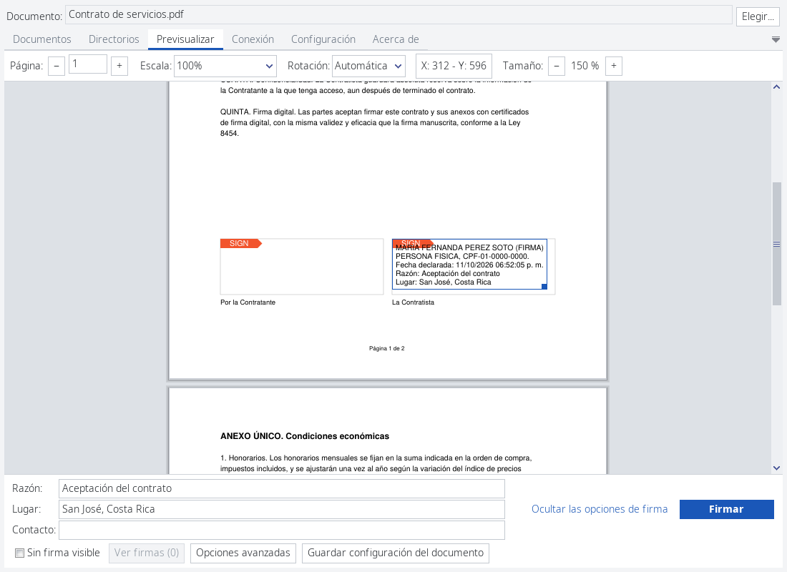
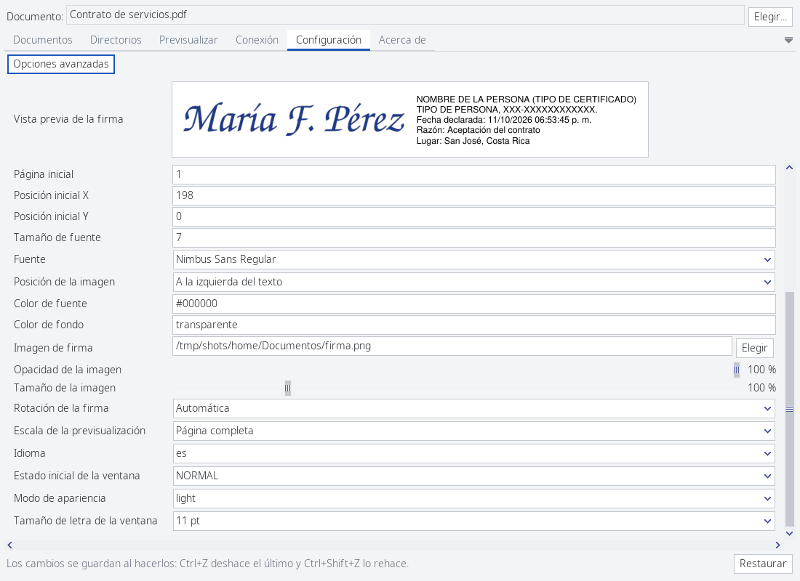
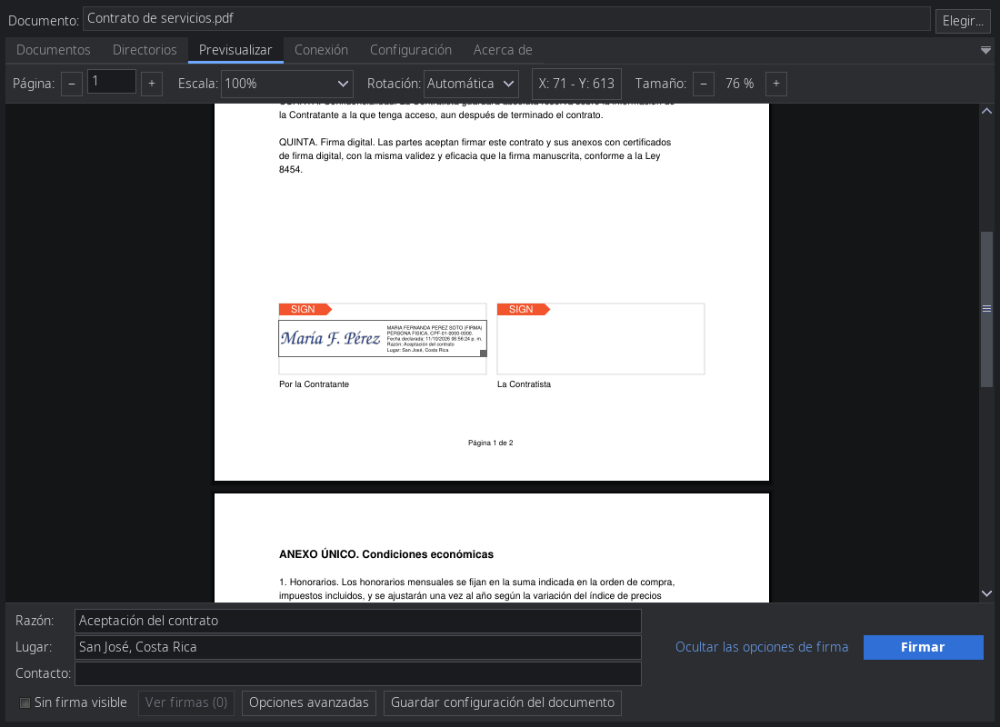

# Firmador Libre

[](https://github.com/NotSpooky/FirmadorLibreD/actions/workflows/ci.yml)

Firme y valide documentos con su tarjeta de firma digital de Costa Rica, en Windows, macOS
y Linux. Firmador Libre firma según la [Política de Formatos Oficiales de los Documentos
Electrónicos Firmados Digitalmente](https://www.mifirmadigital.go.cr/): PDF (PAdES), XML
(XAdES), JSON (JAdES), contenedores ASiC-E, OpenDocument, Office (OOXML) y firmas CMS
(CAdES), con tarjetas de firma digital o con almacenes PKCS#12 (`.p12`/`.pfx`).

Es una versión de [Firmador](https://firmador.libre.cr) reescrita en
[D](https://dlang.org/): un programa nativo más rápido y con una interfaz
renovada, que usa la misma configuración con algunas mejoras que la versión Java.




## Descargar e instalar

Los paquetes de cada versión están en
[Releases](https://github.com/NotSpooky/FirmadorLibreD/releases). Para firmar hace falta
además la tarjeta con su lector y los controladores de
[Soporte Firma Digital](https://soportefirmadigital.com/sfdj/dl.aspx), o un almacén PKCS#12.

**Windows 10 u 11 (64 bits).** Descargue `firmador_windows_….msi` y ábralo: se instala
para su usuario sin pedir permisos de administrador, y queda en el menú Inicio. Desde ahí
Firmador se actualiza solo. También registra los enlaces `firmador:` de Firmador Remoto y la opción
*Abrir con → Firmador Libre* para los documentos que firma. Se desinstala desde
*Configuración → Aplicaciones*. Si prefiere no instalar nada, el `firmador_windows_….zip`
trae el mismo programa para usarlo desde una carpeta.

**macOS 26 o posterior (Apple Silicon).** (Por probar) Descargue `firmador_macos_….zip`, descomprímalo
y mueva `Firmador.app` a *Aplicaciones*. Como no lleva la firma de un desarrollador de
Apple, la primera vez macOS no lo deja abrir: autorícelo en *Configuración del Sistema →
Privacidad y seguridad → Abrir de todos modos* (o con
`xattr -dr com.apple.quarantine /Applications/Firmador.app` en la Terminal). También se
actualiza solo.

**Linux.** Descargue `firmador_linux_….flatpak` e instálelo; usa el runtime de
freedesktop de Flathub:

```sh
flatpak remote-add --user --if-not-exists flathub https://dl.flathub.org/repo/flathub.flatpakrepo
flatpak install --user ./firmador_linux_*.flatpak
flatpak run io.github.notspooky.firmadorlibred
```

Dentro de flatpak, Firmador usa el `pcscd` del sistema para los lectores y las bibliotecas
de las tarjetas instaladas en él (Athena o JCOP4). Cuando hay una versión nueva, avisa con
un enlace a la descarga. También se puede [compilar e instalar en el sistema](#compilar).


## Qué hay de nuevo respecto de la versión en Java

* **Firma sobre los campos del formulario.** Si el PDF ya trae campos de firma vacíos, al
  soltar el recuadro sobre uno se ajusta a él, y la firma ocupa ese campo en vez de agregar
  otro. Si el recuadro tapa anotaciones del documento, Firmador lo advierte antes de firmar
  pero sí permite la firma.
* **Más rápido y liviano.** Es un solo programa nativo, sin máquina virtual de Java.
* **Desplazamiento continuo por las páginas.** El documento se recorre con la rueda del
  ratón o el touchpad, como en un visor de PDF, en vez de requerir pasar de página con un botón.
  Ctrl y la rueda (en Windows, también con el scroll del touchpad) acercan y alejan alrededor
  del puntero.
* **Interfaz adaptable.** La letra de la ventana se agranda o achica con Ctrl y
  más o menos (⌘ en macOS), los cuadros de texto largos se pueden estirar arrastrando su borde, y
  hay tema claro y oscuro según la configuración del Sistema Operativo.
* **Vista previa de la firma.** La firma se ve sobre la página tal como quedará en el PDF,
  y también en la sección de Configuración.
* **Más fácil trabajar con imágenes.** La imagen se ajusta sola al recuadro de la firma; se
  elige si va a la izquierda, a la derecha, arriba, abajo o detrás del texto, su opacidad y
  su tamaño.
* **Configuración sin botones de guardar.** Los cambios se guardan al hacerlos, y Ctrl+Z
  los deshace.
* **Instalador y actualizaciones automáticas**, y los selectores de archivos propios de
  cada sistema.
* **Lectores de pantalla.** La ventana y los diálogos se exponen a los lectores de pantalla
  (UI Automation en Windows, NSAccessibility en macOS y AT-SPI en Linux): cada control con su
  nombre y su descripción, el texto de los campos con el cursor, los avisos al aparecer y el
  recuadro de la firma. Los atajos Alt+letra de la versión Java (Alt+S firma, Alt+N elige
  documentos…) también funcionan.

<p>
  
  
</p>

Igual que en la versión de Java: la configuración (`config.properties`), los textos y el protocolo de
Firmador Remoto son los de la versión Java, así que las páginas y los programas que ya lo
usan siguen funcionando, y las firmas se arman como las armaba la biblioteca
[DSS](https://github.com/esig/dss) de la Comisión Europea que usaba esa versión.


## Uso

### Interfaz gráfica

Abra Firmador desde el menú de su sistema, o con los documentos que quiere firmar.

Para el caso de línea de comandos:

```sh
firmador [documento…]
```

Los documentos indicados, o arrastrados sobre la ventana, quedan listos para firmar. La
primera vez pregunta si usar el **modo simplificado** (una sola vista para firmar) o el
**completo** (lista de documentos, carpetas y conexiones). Los almacenes PKCS#12 se agregan
en *Configuración → Opciones avanzadas*.

`--background` arranca con la ventana minimizada. Si Firmador ya está abierto, abrirlo
otra vez le pasa los documentos a la ventana existente.

### Desde la línea de comandos

Firmar un documento (el PIN se lee de la entrada estándar):

```sh
firmador -dargs entrada.pdf salida.pdf            # con la tarjeta
firmador -dargs entrada.pdf salida.pdf mio.p12    # con un almacén PKCS#12
firmador -dargs -slot1 entrada.pdf salida.pdf     # otra ranura del lector
firmador -dargs -timestamp entrada.pdf salida.pdf # sólo sello de tiempo, sin PIN
```

Atender comandos por lotes desde otro programa (firmar, validar, previsualizar, listar
certificados), con respuestas `SUCCESS`/`ERROR` y JSON:

```sh
firmador -dshell       # escriba «help» para ver los comandos
```

En Windows el ejecutable es de ventana, así que no abre una consola al usarlo con el
ratón. Desde una consola, para que esta espere a que Firmador termine y su salida no se
mezcle con la pregunta del PIN, láncelo con `start /wait /b firmador.exe -dargs …` (cmd) o
`Start-Process -Wait -NoNewWindow firmador.exe -ArgumentList '-dargs', …` (PowerShell).
Un programa que lo use con `-dshell` por tuberías no necesita nada de esto.

### Firmador Remoto

Las páginas web autorizadas pueden pedir firmas al Firmador abierto en la computadora
(puerto 3516 en `127.0.0.1`), igual que con la versión Java. Se activa desde la pestaña
Conexión o con enlaces `firmador:`.


## Compilar

Se necesita un compilador de D ([DMD](https://dlang.org/download.html) 2.113 o posterior,
o LDC), `dub`, `git` (dub descarga con él la copia de dlangui con los arreglos para Windows
y macOS, [NotSpooky/dlangui](https://github.com/NotSpooky/dlangui)), un compilador de C,
`pkg-config` y las bibliotecas de desarrollo:

| Biblioteca | Arch / Manjaro | Debian / Ubuntu |
|---|---|---|
| mupdf | `libmupdf` | `libmupdf-dev` |
| libxml2 y libxslt | `libxml2 libxslt` | `libxml2-dev libxslt1-dev` |
| OpenSSL 3 | `openssl` | `libssl-dev` |
| libcurl | `curl` | `libcurl4-openssl-dev` |
| PC/SC | `pcsclite` | `libpcsclite-dev` |
| libsecret (llavero) | `libsecret` | `libsecret-1-dev` |
| SDL2 y FreeType (ventana) | `sdl2 freetype2` | `libsdl2-dev libfreetype-dev` |

Para usar el selector de archivos del escritorio (GNOME, KDE…) hace falta además
`xdg-desktop-portal` con el de su escritorio, que casi todas las distribuciones ya
instalan; sin él, Firmador usa su propio selector.

Luego:

```sh
dub build                   # genera bin/firmador
dub test                    # ejecuta las pruebas unitarias
dub build -b release        # versión optimizada
```

El paso previo (`tools/prebuild.sh`) reúne las cabeceras de C que ImportC necesita
según `pkg-config`, compila el puente con mupdf y descarga, la primera vez, la biblioteca
de [AccessKit](https://accesskit.dev) con la que la ventana se expone a los lectores de
pantalla (verificada con su SHA-256; para abrirla hace falta `unzip` o `bsdtar`).

Para instalarlo en el sistema, después de `dub build --build=release`:

```sh
sudo packaging/linux/install.sh          # en /usr/local
packaging/linux/install.sh ~/.local      # sólo para el usuario
```

Instala el ejecutable, la entrada del menú (abre PDF, OpenDocument, Office y ASiC-E, y
los enlaces `firmador:` de Firmador Remoto) y los íconos. El flatpak se arma con
`flatpak-builder` y el manifiesto de `packaging/linux/`; ese y el resto de comandos están en
[COMMANDS.md](COMMANDS.md).

### Windows

Se compila en Windows 10 u 11 de 64 bits. La primera vez, en PowerShell abierto como
administrador y desde la carpeta del repositorio (la que tiene `dub.json`):

```powershell
powershell -NoProfile -ExecutionPolicy Bypass -File tools\windows\setup.ps1
```

El script instala lo que falte y al final compila:

* **Programas del sistema**, con Chocolatey: Git, Visual Studio 2022 Build Tools (C++ y
  el SDK de Windows), LLVM y 7-Zip.
* **Dependencias del proyecto**, en `.build\windows`: LDC con `dub`; libxml2, libxslt,
  OpenSSL, SDL2, FreeType y pkgconf compilados con vcpkg; y mupdf compilado desde su
  código. Las descargas se verifican y, igual que los archivos intermedios, se borran al
  terminar.

Todo ocurre en la misma ventana. Como compila OpenSSL y mupdf, tarda un buen rato y
necesita unos 20 GB libres mientras tanto. Para dejar las dependencias en otra carpeta
(sin espacios), se agrega `-DepsRoot D:\firmador-deps` al comando.

Después, para volver a compilar basta, sin administrador:

```powershell
powershell -NoProfile -ExecutionPolicy Bypass -File tools\windows\build.ps1
```

Deja `bin\firmador.exe` junto con las DLL que necesita, incluido el runtime de Visual C++,
así que la carpeta `bin\` (sin `firmador.pdb`, que sólo sirve para depurar) funciona en
otro Windows sin instalar nada más. Con `-Build debug` compila con información de
depuración; si se usó `-DepsRoot` en la instalación, va también aquí. El instalador se arma
después con `tools\windows\installer.ps1`, que necesita [WiX 5](https://wixtoolset.org/)
(ver [COMMANDS.md](COMMANDS.md)).


## Política de firma de código (Code signing policy)

Los paquetes de Windows se firman con un certificado de
[SignPath Foundation](https://signpath.org/), mediante
[SignPath.io](https://about.signpath.io/): *free code signing provided by SignPath.io,
certificate by SignPath Foundation*. Qué se firma, quiénes lo aprueban y cómo están en la
[política de firma de código](CODE_SIGNING_POLICY.md), y lo que Firmador envía a otros
sistemas (sólo lo necesario para firmar, validar y buscar actualizaciones) en
[PRIVACY.md](PRIVACY.md).


## Créditos

Firmador fue creado y es mantenido por sus autores originales:

* Francisco de la Peña Fernández
* Luis Zárate Montero
* Victor Jiménez

y por quienes han contribuido al proyecto a lo largo de los años (ver [AUTHORS.md](AUTHORS.md)).
La versión en D es obra de Christian Durán Carvajal.

* Sitio del proyecto: <https://firmador.libre.cr>
* Código original (Java): <https://codeberg.org/firmador/firmador>

Firmador es software libre bajo la licencia **GPL versión 3 o posterior** (ver
[COPYING](COPYING)), la misma de la versión Java. Usa bibliotecas de otros proyectos con
licencias compatibles: MuPDF (AGPL 3), OpenSSL 3 (Apache 2.0), libxml2, libxslt y libcurl
(MIT y similares), SDL y FreeType (zlib y FTL), pcsc-lite (BSD), libsecret (LGPL), AccessKit
(MIT o Apache 2.0) y dlangui y las bibliotecas de D (Boost). Sus licencias van con cada
paquete: en la carpeta `licencias` del programa en Windows, en `Firmador.app/Contents/Resources/licencias`
en macOS y en `share/licenses` en Linux. Portions of this software are copyright © The
FreeType Project (www.freetype.org). All rights reserved.


## Pendiente (TODO)

* **Firma de los paquetes**: la de Windows espera la aprobación de SignPath Foundation; la
  de macOS necesita una cuenta de desarrollador de Apple para firmar y notarizar (hoy va con
  firma ad hoc). El flatpak de Linux está listo, falta publicarlo en Flathub.
* **Probar en macOS**: el paquete se arma y se prueba en la CI, pero falta usarlo en una
  Mac (llavero, enlaces `firmador:`, actualización).
* **Ícono en la bandeja del sistema**: dlangui no lo ofrece; hoy los avisos con la
  ventana oculta usan las notificaciones del escritorio.
* **Accesibilidad**: probar con NVDA, JAWS, VoiceOver y Orca. En Linux, Orca no recibe la
  opción elegida de las listas desplegables (AccessKit no la publica por AT-SPI).
* **Documentación**: portar el manual de usuario y las preguntas frecuentes.
* **Pruebas**: una configuración de `dub test` sin el aviso del archivo principal, y
  portar las pruebas de la versión Java que falten.
* **Migración de sesiones**: los tokens de las conexiones externas se guardaban en
  `keystore.p12`; esta versión usa su propio almacén cifrado, así que hay que volver a
  iniciar sesión en esos servicios una vez.


## Estructura del proyecto

```
firmador/
├── dub.json                 Proyecto de dub (dependencias, bibliotecas de C)
├── resources/               Lo que va dentro del ejecutable: textos traducidos,
│                            certificados de la jerarquía nacional, plantillas
├── tools/                   prebuild.sh (cabeceras de C y puente con mupdf),
│                            set-version.sh, y los scripts de Windows y macOS
├── packaging/linux/         Flatpak, entrada del menú, AppStream, íconos e instalador
├── packaging/windows/       Instalador (WiX), recursos del ejecutable y la
│                            configuración de firma de SignPath
├── packaging/macos/         Info.plist e ícono de Firmador.app (lo arma tools/macos/bundle.sh)
├── packaging/licenses/      Avisos de licencias de AccessKit (tools/accesskit-notices.sh) y
│                            de los certificados raíz de Windows, y textos de licencias
│                            de bibliotecas de Homebrew que no traen el suyo
├── screenshots/             Capturas de pantalla de este README
└── src/
    ├── c/, shim/            Enlaces a bibliotecas de C (ImportC) y puente con mupdf
    └── firmador/
        ├── app.d            Punto de entrada: elige ventana, -dargs o -dshell
        ├── configuration.d  Constantes (servicios, puertos, límites)
        ├── settings*.d      Configuración del usuario (config.properties)
        ├── asn1/, x509/,    Formatos criptográficos: DER, certificados, CMS,
        │   cms/, crypto/    sellos de tiempo, OpenSSL
        ├── pdf/, xml/,      Firma de cada formato: PDF, XML, JSON, contenedores
        │   jose/, ooxml/,   ASiC/OpenDocument y Office
        │   containers/
        ├── signers/         Un firmador por formato y la elección del formato
        ├── validation/,     Validación de firmas: cadenas, revocación, reportes
        │   validators/
        ├── cards/, tokens/  Tarjetas (PKCS#11, PC/SC) y almacenes PKCS#12
        ├── documents/       Documentos abiertos y colas de firma y validación
        ├── remote/          Firmador Remoto (servidor HTTP local)
        ├── connections/     Conexiones: Gaudi (BCCR) y servicios externos
        ├── plugins/         Plugins (actualizaciones, bitácora de firmas…)
        ├── gui/             Modos de consola (-dargs, -dshell)
        │   └── desktop/     Ventana con dlangui: pestañas, diálogos, vista previa
        └── util/, net/      Utilidades: ZIP, PNG, fechas, HTTP, escritorio
```

Cada archivo empieza con una descripción de lo que hace y de qué parte de la versión
Java proviene. Los acuerdos entre archivos que el compilador no revisa están en
[CONTRACTS.md](CONTRACTS.md), y los comandos para compilar, empaquetar y publicar, en
[COMMANDS.md](COMMANDS.md).
